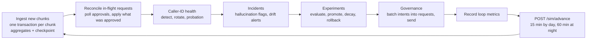
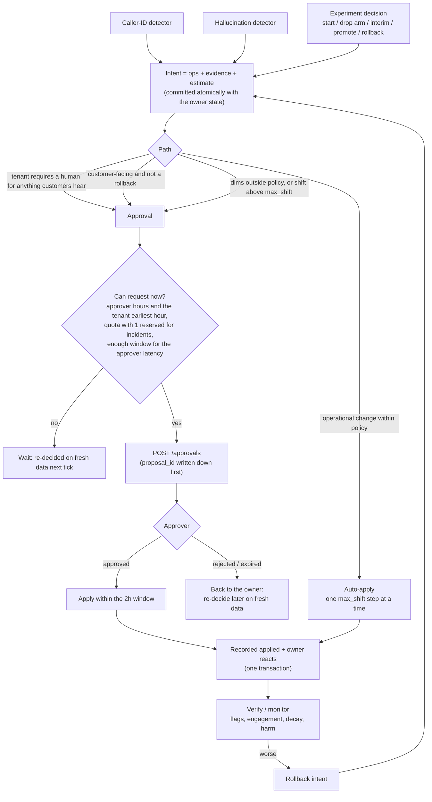
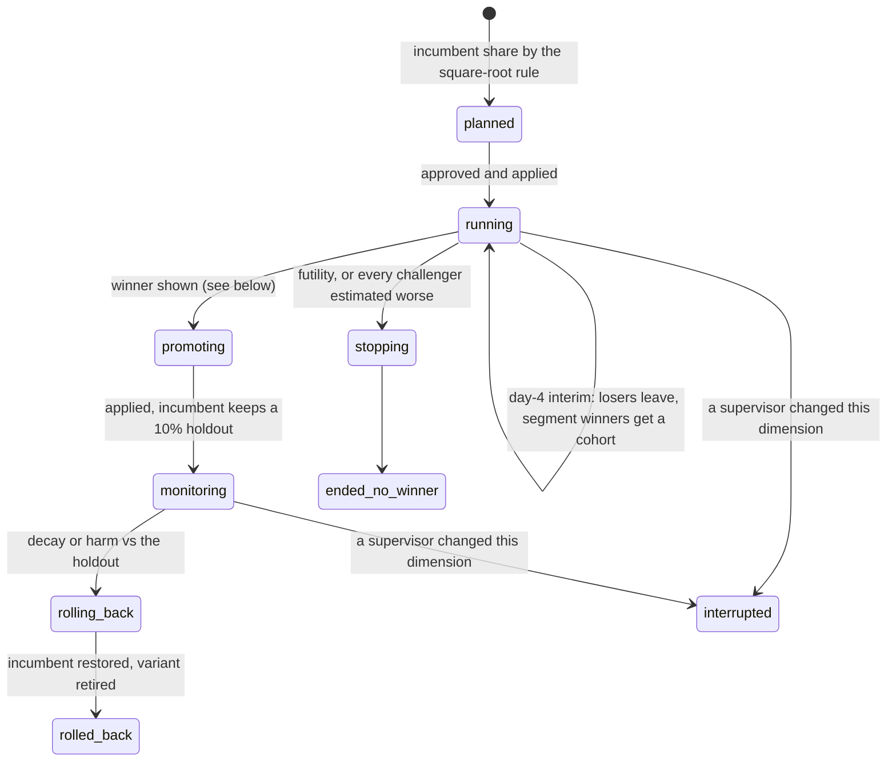
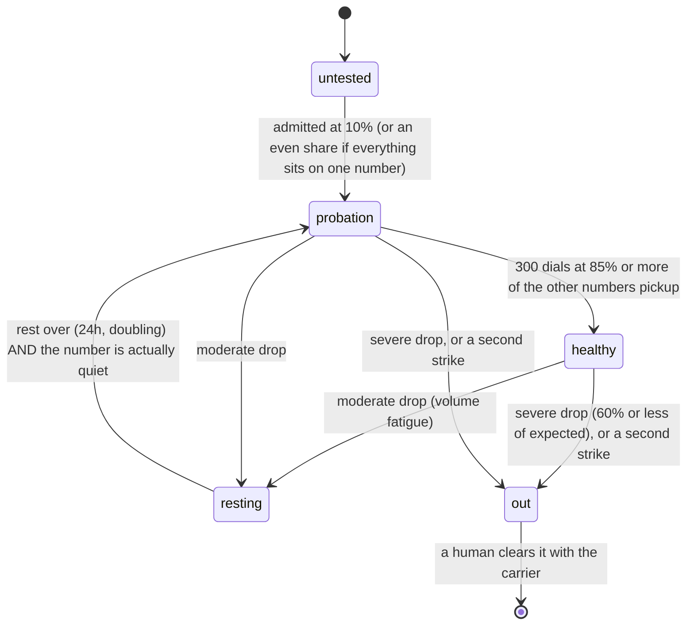
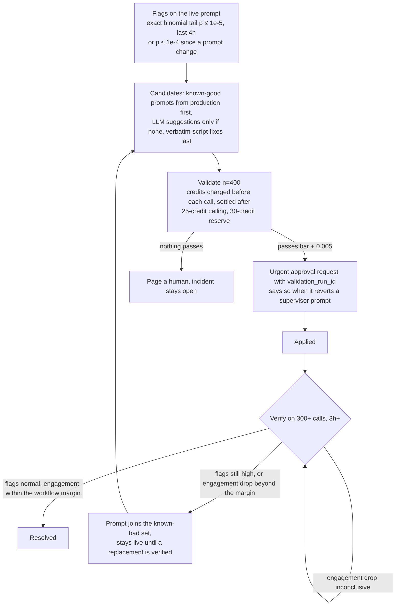
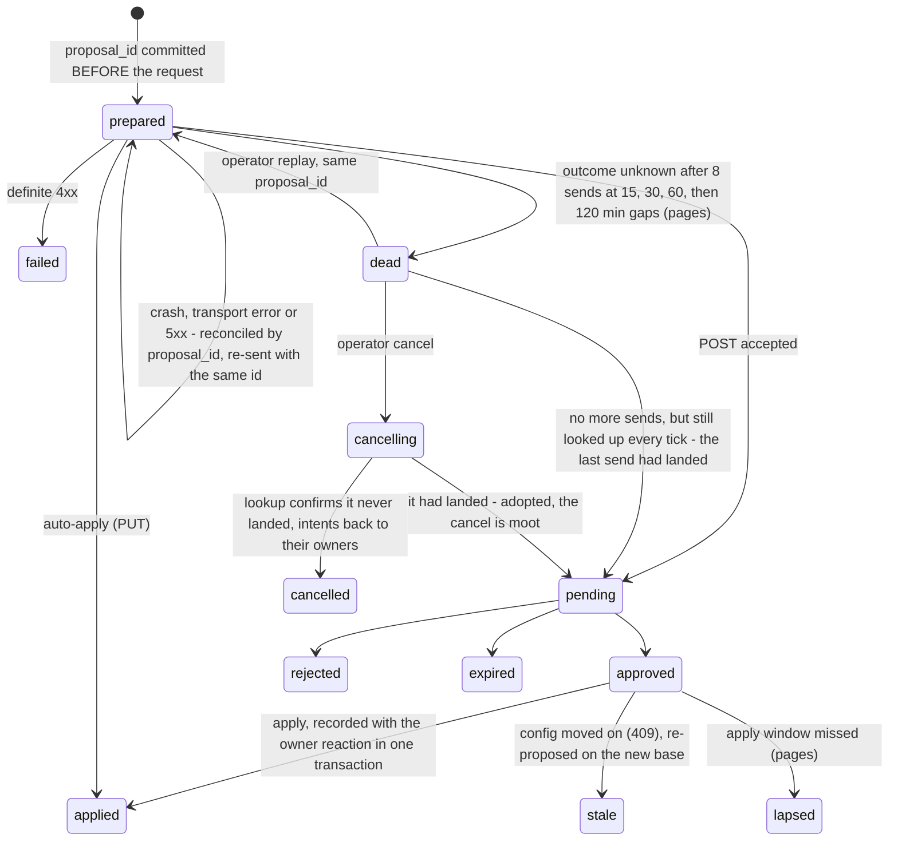

# Outcome-First Agent Loop

**Hackathon-style simulation project** for governed optimisation of outbound voice workflows.

An always-on controller that watches every outbound-calling workflow and, on its own evidence, detects problems,
runs experiments, asks humans for permission in a form they can say yes to, applies what was approved, and rolls
back what stops working. Every decision is explainable from its own store.

- The platform requirements are in [docs/REQUIREMENTS.md](docs/REQUIREMENTS.md), and the simulator contract is in
  [docs/SIMULATOR.md](docs/SIMULATOR.md).
- The architecture, use cases and benchmark results are in [DESIGN.md](DESIGN.md).
- The runbook for the engineer on call is [docs/CONTROLLER.md](docs/CONTROLLER.md).
- The [architecture overview](deliverables/Outcome_First_Agent_Loop_Architecture.pdf) and [source archive](deliverables/Outcome_First_Agent_Loop_code.zip) provide a portable handoff.

## At a glance

Representative hackathon benchmarks across three bundled scenarios, compared with a no-op controller.
Each row below comes from one complete simulation run; repeated runs vary with approver decisions and workflow responses.
The summary command is `python -m sim grade`.

| scenario | leads concluded vs baseline | changes applied | harmful |
|---|---|---|---|
| public_01 (3 workflows, 8 days) | **+16.1%** | 12 | 1 (an undecided test ended back on the incumbent) |
| public_02 (incidents, 10 days) | **+28.4%** | 14 | 0 |
| public_03_load (12 workflows, ~840k events/day) | **+21.8%** | 57 | 1 (a 10% probe of an untested caller ID) |

- **Crash recovery.** The controller was hard-killed 8 times during public_02. All 7 invariants held: nothing was
  applied twice, no approval was lost or lapsed, and every chunk was ingested exactly once
  ([report](reports/crash_recovery_public_02_incidents.md)).
- **Scale.** 60k–85k events/s, and 18–33 s of wall-clock time per simulated load day including the simulator
  (the SRE target is under 10 minutes). Peak memory is ~770 MB.
- **Tests.** 83 tests (6 for the simulator, 77 for the controller, including an end-to-end smoke run of the wired controller against the real simulator), covering the failure paths: crashes between
  any two writes, lost responses, stale approvals, competing controller processes and statistical edge cases.

## Quick start

```bash
pip install -r requirements.txt

# the contract: run against any simulator until its scenario ends
./run.sh http://127.0.0.1:8700

# serve a scenario, run the controller end to end, grade it (refuses to grade a failed or unfinished run)
python scripts/run_scenario.py scenarios/public_02_incidents.yaml --tag my_run

# kill -9 the controller 8 times mid-run, restart it, verify every invariant
python scripts/crash_test.py scenarios/public_02_incidents.yaml

# unit tests
python -m pytest -q tests

# ask the controller's own store (read-only, never touches the simulator)
python -m controller why    --db state/my_run.db --workflow ks_cancel --at "D3 20:00"
python -m controller view   --db state/my_run.db              # the supervisor's one screen
python -m controller health --db state/my_run.db              # throughput, lag, credits, pages
python -m controller view   --db state/my_run.db --tenant kestrel_finance   # one client sees only its own
python -m controller replay --db state/my_run.db --proposal <id>            # re-send a dead-lettered request
```

Requirements: Python 3.10+ and the packages already in `requirements.txt`. The controller adds no new
dependency, and all of its state lives in one SQLite file (`state/controller.db`, or `CONTROLLER_DB`).

---

## The workflow

### 1. One tick of the loop

The simulator only moves when the controller advances it. Each iteration does the same six steps, and each step
reads its state from the store, so the process can be killed between any two of them.



A failing step is isolated: it pages, changes nothing (its transaction rolls back), and is retried next tick.

### 2. From a signal to a live change

Nothing changes a workflow's config except governance. Detectors and experiments file **intents**: replayable
ops plus their evidence. Governance turns them into one batched request per workflow, through the path the
policy and the clients allow.



**Who sees what.** Every read can be scoped to one client: `--tenant kestrel_finance` shows that client's
workflows, decisions and alerts only, and none of the platform-wide operator alerts. Without it, the operator
sees everything.

**Rules that are never relaxed:**

- **Customer-facing changes** (welcome, voice, prompt, cohorts) always go to a human. The one exception is a
  change that only returns traffic to what a human already approved, and even that exception never applies to
  Northwind.
- **Supervisor edits are never overwritten.** A dimension a supervisor set by hand is left alone for a week.
- **Prompt changes always carry a validation run.** The approver rejects them otherwise, and we never send one
  without.

### 3. Experiment lifecycle

Engagement-primary workflows test **welcome message** and **voice** concurrently. The simulator samples each
independently per dial, so both comparisons use all traffic.



**What "winner shown" means.** Every condition below must hold:

1. Arms are compared only within a (config version, day) stratum, where traffic shares are fixed. The strata are
   then combined with a Mantel-Haenszel estimate, so a traffic-share change during a time trend cannot
   manufacture a lift.
2. An always-valid confidence sequence (mSPRT, α split across challengers) on the primary KPI excludes zero. That
   stays valid however often we look.
3. Every arm has at least 300 trials.
4. The guardrail KPI is *shown* non-inferior: its lower bound sits above the workflow's −margin.
5. Over the last 24h the variant is still at least half as far ahead as overall, so a fading variant isn't promoted.
6. There is no harmful interaction with the other dimension.

**Decay.** A drift-adjusted CUSUM against the holdout, plus a drop in the winner's own rate. The lift it is
measured against is shrunk to correct for the winner's curse.

### 4. Caller-ID health

A number's reputation degrades with its volume, so volume is spread evenly over healthy numbers. Each number has a
state:



Detection compares each number with the others *within the same cohort and hour*, then sums. It uses two windows:
a fast one (2h, extended to at least 150 dials) and a slow one (12h). The threshold is z ≤ −4.5 with pickup at
75% of expected or less. Mitigation auto-applies where policy allows (in `max_shift` steps, 30 minutes apart)
and otherwise goes as an urgent approval request.

### 5. Hallucination incident



An incident never closes because "the prompt changed". A prompt someone else puts live mid-incident is verified
exactly like one of ours.

### 6. Proposal lifecycle and crash safety



**What makes a kill at any moment safe:**

| hazard | protection |
|---|---|
| Crash in the middle of a chunk | Aggregates and the checkpoint commit together, so the chunk is replayed whole or not at all |
| Crash after sending a request, before recording it | `proposal_id` is written first; restart looks it up in `GET /approvals` or config history |
| Lost response to a request that did land | Stays `prepared`; adopted on reconcile, never re-applied (`409 duplicate` and `409 not_approved {applied}` mean "look it up") |
| Crash between applying and the owner's state change | Both are in one transaction; the simulator still says `applied`, so the next tick replays it once |
| Crash between filing an intent and saving the decision it rests on | `@atomic` decisions: both commit or neither does |
| Lost response to a paid call (validation, LLM) | The charge is persisted first and settled against the simulator's balance; the ceiling always holds |
| `advance` response lost | `/sim/state` is re-read before any retry, so time never moves twice |
| A request that keeps failing ambiguously | Re-sent with the same id on a backoff (15, 30, 60, then 120 simulated minutes); dead-lettered after 8 sends with a page. Dead means no more sends, never no more lookups: if the last send landed with its response lost, the next tick adopts it. `replay` re-sends it with the same id; `--cancel` hands the work back only once a lookup confirms it never landed |
| Controller restarted while another one still holds the store | The world is read only after the lease is held, so a store the previous holder kept advancing during the wait is resumed, not archived as "from the future" |
| Two controller processes on one store | Leases: the `world` lease to move the clock, a `workflow:<id>` lease to change a workflow; heartbeat renewed every tick; a killed holder is replaced at once, a silent one after 120 s; every write is fenced on the lease; a process that loses one stops acting |
| Same scenario restarted from scratch | The store must match the simulator's own records (chunks, config history, approvals) before it is resumed; otherwise it is archived |

### 7. Statistics in one table

| question | method | guarantee |
|---|---|---|
| Is a challenger better? | Stratified Mantel-Haenszel difference, always-valid mSPRT confidence sequence, Bonferroni over challengers | False winners ≤ 5% per experiment, asymptotically; measured 0–3.7% in simulation under repeated looks |
| Does it work for a segment? | The same, per single-feature segment, Bonferroni over a family fixed in advance (segments × challengers) | ≤ 5% for all segment claims of an experiment, at any number of looks |
| Is the guardrail safe? | Always-valid lower bound of the guardrail difference above −margin | Non-inferiority shown, not "not disproven" |
| Did a winner decay? | Drift-adjusted Bernoulli CUSUM vs the holdout, threshold log 100, plus a drop in the winner's own rate | Robust to global drift and to the winner's curse |
| Is a caller ID bad? | Stratified (cohort × hour) observed vs expected, z ≤ −4.5 | ~3×10⁻⁶ per look |
| Is a prompt hallucinating? | Exact binomial tail vs the history flag rate | p ≤ 1e-5 (1e-4 just after a prompt change) |

---

## Repository map

```text
controller/
  loop.py          the tick loop, world-continuity check, loop metrics
  leases.py        one process per world and per workflow: heartbeats, takeover, fencing
  api.py           HTTP client: per-call retry rules (advance never twice, credits never retried)
  ingest.py        chunk ingestion, lead/feature joins, aggregates
  governance.py    intents -> batched requests, path choice, timing, quota, reconciliation, apply
  callerid.py      caller-ID state machine, stratified detection, rotation
  incidents.py     hallucination response, credit accounting, drift alerts
  experiments.py   experiment lifecycle, segment cohorts, promotion, decay, rollback
  estimates.py     affected leads, dry-run replay, impact score
  stats.py         mSPRT, Mantel-Haenszel, exact binomial, Dunnett split
  audit.py         why / view / health / log (read-only), scoped per tenant with --tenant
  settings.py      every threshold with its reason; tenant rules (Northwind, Kestrel)
scripts/
  run_scenario.py  serve + run + grade; refuses to overwrite evidence or grade a failed run
  crash_test.py    8 hard kills and 7 invariants
tests/ctl/         77 controller tests (end-to-end smoke run, failure paths, leases, statistics, governance, incidents, caller ID)
reports/           benchmark summaries for public_01, public_02, public_03_load; crash-recovery report
docs/CONTROLLER.md runbook: alerts -> actions, lifecycles, how to extend
docs/REQUIREMENTS.md platform requirements and capability catalogue
use_cases/         sales, compliance, operations, product and reliability requirements
deliverables/      architecture PDF, diagrams and source archive
DESIGN.md      architecture, use-case decisions, benchmark results and limitations
```

## Evidence

| file | what it shows |
|---|---|
| [reports/public_01.md](reports/public_01.md) | Benchmark summary for the development scenario |
| [reports/public_02.md](reports/public_02.md) | Benchmark summary for the incident scenario (flagged number, bad prompt, supervisor edit) |
| [reports/public_03_load.md](reports/public_03_load.md) | Benchmark summary for the 12-workflow load scenario; timings in [DESIGN.md §8](DESIGN.md) |
| [reports/crash_recovery_public_02_incidents.md](reports/crash_recovery_public_02_incidents.md) | Kill points, invariant checks, outcome of the crashed run |
