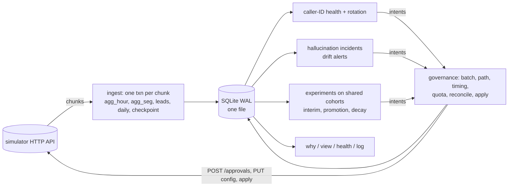

# Outcome-First Agent Loop — Submission

**Name:** Pardeep Singh (<sandhupardeep300@gmail.com>) · **Date:** 8 November 2026 · **Hours actually spent (be honest):** 5 · **Language / storage:** Python 3.12, stdlib + `httpx` (already in requirements) / one SQLite file (WAL)

> How to run, debug and extend it: [docs/CONTROLLER.md](docs/CONTROLLER.md). Every threshold and the reason for its
> value: [controller/settings.py](controller/settings.py).

---

## 0. TL;DR

- An always-on controller that ingests every event into hourly and per-segment aggregates. It detects caller-ID degradation and hallucination spikes on populations, and runs always-valid experiments on welcome message and voice. Every change goes through governance as one batched, evidence-carrying request per workflow, and every decision lands in its own audit store.
- **public_01: +16.1% leads concluded vs the no-op baseline, 12 changes applied, 1 harmful. public_02: +28.4%, 14 changes, 0 harmful. public_03_load (12 workflows): +21.8%, 57 changes, 1 harmful.** The two harmful changes are small: ending an undecided test back on the incumbent (−0.022), and a 10% probation probe of an untested caller ID that turned out bad (−0.041, detected and removed). In public_02 the spam-flagged number was off rotation 2h30m after the flag. The supervisor's bad prompt was detected 1h45m after it shipped and reverted through a human 2h30m after (grader MTTR 150 min).
- A hard-kill test (8 × SIGKILL at bootstrap, mid-apply-window and at random times) finishes with every invariant intact. The load scenario runs at 60k–85k events/s, about 10–18 s of controller time and 18–33 s of wall time per simulated day including the simulator, depending on machine load (SRE asked for < 10 min). Peak memory is ~750–780 MB.
- Single runs are noisy: approver judgement calls and the world's response to our changes vary. Across our last eight full runs, the harmful count per run was 0–2 per scenario. Fixes and additions from six rounds of external code review (leases so two controller processes can never act on one workflow, backoff and dead-lettering for requests whose outcome stays unknown, tenant-scoped reads, Northwind's no-auto-apply rule enforced even for rollbacks, store-to-world continuity checked against the simulator's records, crash atomicity of outcomes and of decisions, ambiguous request outcomes, guardrail non-inferiority, incident closure, credit reserve and charge-before-spend, stratified caller-ID and experiment comparisons, workflow-specific engagement margins, per-workflow cohort keys, a harness that cannot grade a failed run, honest error-rate claims) are described in §5–§9.
- **Deliberately not built:** per-person call-time optimisation (C4), cross-tenant fairness (C15), a UI (the supervisor view is a CLI over the store). Bootstrapping (C3) is used only for baselines.

## 1. Assumptions

1. A guardrail `pickup_rate_max_drop: 0.02` is an absolute drop of 2 percentage points, not 2% relative.
2. A welcome message or voice is heard after the call connects, so it cannot move pickup. Pickup-primary workflows are served by caller-ID policy, not by greeting experiments.
3. A number's reputation degrades with its volume (carrier spam labelling). Our own data shows it. `nw_kyc` D1 at 2,000 dials/day slid from 35% to 24% pickup over the history, and recovered to 34–35% within two days of being spread across three numbers.
4. A pickup drop to ≤ 60% of expected looks like spam labelling (persistent, needs the carrier). A milder drop looks like volume fatigue (recovers with rest).
5. Caller-ID rotation is an operational setting covered by the signed policy where the policy's auto-apply allows `caller_id`. Where it doesn't (KYC), rotation goes to the approver like anything else.
6. Customer-facing means welcome message, voice, prompt and cohorts. Those always go to a human, even where policy would allow auto-apply. The exception is a change that only moves traffic back toward what a human already approved (a rollback or a harmful-arm drop), which may auto-apply where policy allows. That exception never applies to a tenant that requires a named human for anything a customer hears: Northwind (stakeholder 02). There, rollbacks also go to the approver.
7. Hallucination flags are a noisy but unbiased detector. The pre-D0 rate (~1.4% of connected calls) is "normal". Validation measures safety only, never engagement.
8. An approver's latency counts within approver hours. A request with less approver time left than the worst-case latency is likely to wait overnight, and with a 12h TTL it can expire before morning (we observed this while probing the API).
9. Tenant ids in hidden scenarios may differ. Tenant preferences ([settings.py](controller/settings.py)) apply only where the tenant id matches; otherwise policy plus the global rules apply.
10. The store may be a local file. On the graders' box `./run.sh` writes `state/controller.db`. Before resuming, the store is checked against the simulator's own records: every chunk it ingested must be listed with the same event ids, every config version it recorded must be in the simulator's config history with the same actor and `proposal_id`, and every approval it holds must exist. A different scenario, or a fresh run of the same scenario (which looks identical by name and size), fails that check. The old store is then archived next to the new one and the controller starts fresh.

## 2. Scope decisions

| # | Capability | Built / Partial / Cut | Why | What it would take to finish |
|---|---|---|---|---|
| C1 | Event ingestion | **Built** | Everything depends on it; one transaction per chunk (aggregates + checkpoint) makes it idempotent and restartable | Partition by workflow across processes (§8) |
| C2 | Lead/feature joins, one shared cohort object | **Built** | Leads are joined to features on ingest; cohort ids are the same in config, detection scope, experiments, proposals and the view | Multi-feature cohorts |
| C3 | Bootstrapping from history | Partial | History gives baselines (hour-of-day pickup, engagement, flag rate) and detector references; it is all one config, so it says nothing about variants | Off-policy use of history for call-time (needs C4) |
| C4 | Call-time optimisation | **Cut** | Needs a per-person or per-cohort pickup model and schedule experiments, which is a second learning loop. The incidents and governance work protected more outcome per hour of effort | Hour-weight experiments per cohort with the same machinery; per-person preferred hour from history |
| C5 | Caller-ID health | **Built** | The largest lever in the public data (+26–36% pickup on two workflows) | Carrier integration to clear numbers |
| C6 | Variant experimentation | **Built** | The core learning loop | Thompson-style adaptive allocation once approvals allow it |
| C7 | Promotion, decay, rollback | **Built** | Winners decay in this world ("for how long") | A larger holdout or periodic re-tests for partial decay (§13) |
| C8 | Hallucination response | **Built** | A bad prompt is the costliest incident (customers misinformed) | Engagement-aware fix ranking from history |
| C9 | Governance client | **Built** | The non-negotiable boundary; most of the review is about it | — |
| C10 | Impact, affected leads, dry runs | **Built** (honest, simple) | Approvers reject requests without them; Product ranks by impact | Per-lead counterfactuals |
| C11 | Supervisor view | Partial (CLI) | One screen exists (`python -m controller view`), scoped per client with `--tenant` so a supervisor never sees another client's workflows; no UI | A read-only HTTP endpoint over the same queries, with the tenant taken from the caller's identity |
| C12 | Decision/audit store | **Built** | Floor requirement and the live review | — |
| C13 | Crash recovery, demonstrated | **Built** | SRE non-negotiable | — |
| C14 | Loop observability | Partial | Per-tick metrics, page/warn alerts with a runbook (`health`); no external metrics push | Prometheus endpoint |
| C15 | Fair allocation across tenants | **Cut** | Per-incident credit ceilings and per-workflow quotas exist; there is no global allocator | A credit budget per tenant per day |

**Principle:** build whatever keeps the platform from hurting a customer or breaking a contract first (C1, C9, C12, C13, then C5 and C8, the incidents). Then build the learning loop on the same machinery (C2, C6, C7, C10). Anything that needs a second model of the world (C4) is cut, as is anything that only matters across many tenants (C15).

## 3. Stakeholders

### 01 — Nikhil Rao, VP Sales
- **Accepted.** Speed where it is safe: experiments start in the first approver window of D0; caller-ID incidents are mitigated in minutes where policy allows auto-apply. Each workflow shows its pickup and engagement lift on one screen.
- **Declined.** A single blended score: Product's definitions and the README both forbid blending. "Winning by lunch, live by evening": a winner needs ≥ 300 trials per arm, an always-valid test and to still be ahead over the last 24h; a 5 pp effect takes 5–9 days to prove at today's traffic. Rolling out the persuasive prompt (P4) wherever possible: a prompt change needs a validation run at ≥ 97% pass rate plus a human. In one of our test runs P4 scored 96.5% on `nw_renewal`.
- **Wrong against policy.** "Kestrel turned on auto-apply for everything": `ks_cancel` auto-applies only schedule, caller ID, welcome and voice, at most 20% of traffic per change, never prompts or cohorts. "Northwind is fine with auto-apply on KYC": `nw_kyc` has auto-apply disabled.
- **Reply.** _Nikhil — you'll have a per-client number for the summit: pickup and engagement lift vs. a no-change baseline, side by side (we can't blend them; Product and our clients' contracts define them separately). The loop moves fast where it's safe: number rotation fixes in minutes, tests start on day one. Promotions need proof, though. A 5-point gain takes about a week to prove at today's volumes, and an unproven "winner" is how we'd end up explaining a bad week to Northwind's board. One correction: Kestrel auto-applies only four settings, in 20% steps, and Northwind's KYC flow has no auto-apply at all. The persuasive prompt hasn't passed safety validation yet._

### 02 — Meera Iyer, Compliance, Northwind
- **Accepted, all five.** No customer-facing change without a named approval. We never auto-apply welcome, voice, prompt or cohorts for Northwind, even where a policy would allow it, and not even to roll something back (a tenant rule in `settings.py`, enforced before any other exception). Script changes carry `validation_run_id`, and the request says what it validated and what it didn't (engagement). Auditor questions are answered from our store (§10) in seconds. "Slow and right": harmful arms are dropped as soon as an always-valid test or a strict last-24h test shows harm; a segment where a winner is worse keeps the incumbent; nothing is promoted that isn't still ahead over the last day. Approver hours are respected: routine requests go only when there is approver time left for the worst-case latency, so KYC requests go at 10:00.
- **Wrong or incomplete.** "Call timing and caller-ID rotation are covered by the policy we signed" holds for renewal, not KYC: `nw_kyc` has auto-apply disabled, so number rotation on KYC also comes to your approver. "Why did this customer hear what they heard": our store answers per cohort, config version and time, with the reason. The exact variant a single customer heard is on the dialler's call record (every call carries `config_version` and `variant`). We aggregate it, so a per-customer answer needs that join (§13).
- **Reply.** _Meera — agreed on all five, and built that way. Nothing a customer hears changes without your approver; script changes arrive with a validation run attached; we answer "what was live for whom, since when, approved by whom, and why" from our own records in minutes. Requests come inside 10:00–19:00 (KYC 10:00–18:00) and early enough to be decided the same day. One clarification: KYC's policy has no auto-apply at all, so caller-ID rotation on KYC will also come to you for approval. Renewal's rotation runs under the signed policy and is listed in the weekly summary._

### 03 — Kabir Menon, Platform & SRE
- **Accepted.** Kill/restart: tested with 8 hard kills, all invariants hold (§9). Idempotency: the `proposal_id` is committed before every request and reconciled from the simulator's own records after a crash; a chunk is ingested in one transaction with its checkpoint. Actionable alerts: pages vs. warnings, each with a runbook entry ([docs/CONTROLLER.md](docs/CONTROLLER.md#runbook-alerts)). Loop health without logs: `python -m controller health`. Load: one load-scenario day in ~18–33 s wall time including the simulator (~10–18 s of it ours), depending on machine load.
- **Pushed back, slightly.** The store is SQLite: an embedded file, not a server, so nothing new to run at 2 a.m. (back it up by copying it). In production I'd move the same schema to the Postgres you already run; the per-chunk transaction and `proposal_id` reconciliation don't change.
- **Reply.** _Kabir — kill/restart is demonstrated, not promised: eight SIGKILLs (bootstrap, inside an approval's apply window, random times), then checks that nothing applied twice, no approval was lost or lapsed, every change is in the audit store and every chunk was ingested exactly once (reports/crash_recovery_public_02_incidents.md). A load day takes ~20 s on a laptop, far under your 10 minutes; memory is what breaks first at 10×, and the fix is in the doc. State is one SQLite file, embedded, no server; for production I'd put the same schema in our Postgres. Pages are only things a human must act on, each with a runbook line._

### 04 — Anita Desai, Ops supervisor, Kestrel
- **Accepted.** We never undo her edits. A supervisor edit is recorded, stops any experiment on that dimension from counting, and ends our experimentation on that dimension for a week. When her mid-day prompt (P2) more than tripled hallucination flags in public_02, we asked her approver to revert it, with validation evidence and a rationale that says it reverts a supervisor's change; we never overwrote it. Her limits are stricter than her policy (4 requests/day, from 10:00), so we follow hers: at most two requests a day, never before 11:00, several changes batched into one request. One screen: `python -m controller view`. Fixes that read the compliance script verbatim are ranked last.
- **Partially declined.** "Tell me before anything changes on a running campaign": anything customers hear waits for her approval. Caller-ID rotation during an incident is applied within her policy immediately and shown on the screen right after, because a spam-flagged number loses ~2/3 of pickups every hour we wait.
- **Reply.** _Anita — your edits are never undone. If one of them causes trouble (your P2 prompt tripled hallucination flags in one of our tests), we send you a request to change it back, with the evidence, and you decide. You'll get at most two requests a day, never before 11:00, each bundling everything we want. Anything a customer hears waits for your yes. The one thing we change without asking is which phone number we dial from, and only when a number is getting flagged as spam; it shows on your screen right away. And no verbatim-script "fixes": we rank those last._

### 05 — Tara Kulkarni, Product
- **Accepted.** Separate KPIs everywhere. One cohort object: the `cohorts` table, with the same id in config, detection scope, experiments, proposals and the view. Minimum size and window: no decision before 300 trials per arm; segments need 200 per arm; a planned interim at 4 days. The cost: proving a 5 pp effect needs ~1,800 connected calls per arm (5–9 days here), 8 pp needs ~740 (2–4 days), 12 pp needs ~370 (1–2 days). The always-valid design keeps false winners within 5% per experiment even with hourly looks. That holds asymptotically, not by construction (it uses a normal approximation). In simulation across base rates, arm counts and horizons the measured rate is 0–3.7% (`tests/ctl/test_stats.py`). Every request carries an impact score, diff, affected leads and a dry run (§6). Expired means rejected: re-queued with fresh data. Only calls that ran are evidence. Winners change their own workflow only.
- **Declined.** Per-person call time as a P0: cut (C4). It is a second model with its own experiments, and it would have cost the incident and governance work. Supervisor view: built as a CLI, not a UI. Caller-ID health: built, and it was the largest win.
- **Reply.** _Tara — your definitions are the controller's: pickup and engagement never blended, one cohort id end to end, every request with impact, diff, affected leads and a dry run, expired treated as rejected and re-queued fresh, and only calls that actually ran count. On cohort size: we decide at 300 calls per arm, which proves 8-point effects in 2–4 days and 5-point effects in about a week, with false winners kept within 5% per test (asymptotically; 0–3.7% in our simulations). I cut per-person call time: it's a second model, and doing it badly is worse than not yet. Caller-ID health and the supervisor view (as a command, not a UI) are in._

### 06 — Aryamann, CTO
- **Accepted.** Explainability first: every change answers "why, who approved, what next" from our store (§10). No harm: one small harmful change in public_01 (an undecided test ended back on the incumbent), none in public_02, 1 of 57 in the load run (a 10% probe of an untested caller ID); a variant must now be shown non-inferior on the guardrail before promotion; segments where a winner is worse keep the incumbent. Credits where they change a decision: 4 credits in public_02 (one validation); the LLM is called only when no known-good prompt exists; per-incident ceiling 25, reserve 30. Scale (§8) and what breaks first. Choosing: the table in §2. Docs for the on-call engineer: [docs/CONTROLLER.md](docs/CONTROLLER.md).
- **Caught in the memos.** Kestrel's auto-apply isn't "everything"; KYC has no auto-apply; Northwind's "caller-ID rotation is covered" doesn't hold for KYC; Kestrel's supervisor limits are stricter than her policy; the persuasive prompt hasn't passed validation.
- **Reply.** _Aryamann — I chose governance, incidents and an honest learning loop over breadth: C1, C2, C5–C10, C12 and C13 are built; C4 and C15 are cut, with the messages to Product and Sales drafted. Every change in the public runs can be explained from our store; the grader rates one in public_01 and one in the load run as mildly harmful, and §11 says which and why. Credits went to one validation run. What breaks first at 10×, and the fix, is in §8. The memos' wrong assumptions are listed in §3._

## 4. Architecture



Per tick: ingest → reconcile in-flight requests (apply what was approved) → caller ID → incidents → experiments → submit batched requests → metrics → `POST /sim/advance` (15 min during working hours, 60 at night). All state is in the store. On restart the controller re-opens the store (same world fingerprint) and every step re-reads its state. In-flight requests are reconciled by `proposal_id`. Partially-ingested chunks never exist, because ingestion is one transaction per chunk. A failing step is isolated: it pages, changes nothing, and the loop continues.

## 5. The learning loop

- **Cohorts.** Experiments run on the default population. The single analysed unit is a single-feature segment (`lang`, `city_tier`, `age_band`, `value_band`, 13–14 values per workflow), each needing ≥ 200 trials per arm before it is analysed. Cohort records are keyed by (workflow, cohort), since names like `lang_ta` repeat across workflows. Cohorts are created only from evidence, all from one feature per experiment so they never overlap, and at most three per experiment. Traffic never fragments into tiny cells: the experiment is randomised per dial over the whole population, and segments are a planned analysis of that, not separate experiments.
- **Experiment design.** Fixed allocation for the life of an experiment, with the incumbent's share set by the square-root rule (41% with 2 challengers, 37% with 3). That is both the most powerful split for comparisons against one control and a cap on exposure. Exploration vs. exploitation is staged: explore at those shares; drop harmful arms early; at the 4-day interim drop arms estimated worse (overall or over the last day) and keep testing the rest; exploit with a 10% holdout. **Welcome × voice** run concurrently as a factorial: the simulator samples each dimension independently per dial, so each comparison uses all traffic. Before promoting, the winner is checked within every level of the other dimension; a significant qualitative interaction (z ≤ −3) blocks promotion.
- **Deciding a winner.** Arms are only ever compared *within* a (config version, day) stratum, where assignment probabilities are constant, and the strata are combined with a Mantel-Haenszel risk difference and its variance. The interim moves traffic shares while rates drift over time, so pooling across versions would manufacture lifts (Simpson's paradox; a test reproduces a 13 pp false lift that the stratified estimate puts at 0). On that estimate: always-valid mSPRT confidence sequences (normal mixture, τ = 5 pp) on the primary KPI, at α/k (Bonferroni over k challengers), looked at hourly. A winner needs all of: sequence > 0; every arm ≥ 300 trials; guardrail **non-inferiority shown**, meaning the guardrail sequence's lower bound is above −margin; over the last 24h still at least half as far ahead as overall (a fading variant fails this); no blocking interaction; and a request that can go out now. Segments use always-valid sequences too, at α/m. The Bonferroni family m (every segment value × every original challenger) is fixed in advance, so looking at the interim and again at conclusion keeps the guarantee. **False-claim rate, honestly stated:** workflow-level claims ≤ α = 5% and segment claims ≤ 5% per experiment (≤ 10% for either kind, by the union bound). Both hold *asymptotically*, because the sequences use a normal approximation with plug-in variances, and decisions wait for ≥ 300 trials per arm (≥ 200 in a segment) to stay in that regime. The rules layered on top (recency, interaction, interim drops by point estimate) only ever *remove* claims, so they cannot raise these rates. Measured in A/A simulations with repeated looks (`tests/ctl/test_stats.py`): base rates 5–50%, 1 or 3 challengers at the square-root split, with and without the 300-trial gate, 120 looks: 0–2%. Over 1,000 looks (~60k trials per arm) the rate climbs to ~3.5%, approaching α as it should. For the 39-comparison segment family: within 5%. A fixed-sample test peeked at as often exceeds 10%. Rare outcomes (1–2% base rates) come out very conservative (~0.3%) because of add-one variance smoothing.
- **Decay and rollback.** Every promotion keeps 10% on the incumbent. Decay is checked hourly with two signals. The first is a drift-adjusted Bernoulli CUSUM: each hour, H1 is the holdout's trailing rate and H0 is that plus the *shrunk* promoted lift; the threshold is log 100. The second is the winner's own last-24h rate significantly below what it was promoted on (z ≤ −2). Shrinking the lift (max of the sequence's lower bound and half the estimate) corrects the winner's curse. Without it, ordinary regression to the mean right after a promotion looked like decay. Being significantly worse than the holdout rolls back on its own. Carved cohorts roll back on harm only. Inside a running experiment, an arm significantly worse over the last 24h (α = 0.002) is dropped, which is how a variant that starts decaying mid-test is caught.
- **Call time and caller ID.** Call time is cut (C4); history is used only for hour-of-day baselines. Caller ID is a policy, not an A/B winner. Volume is spread evenly over healthy numbers; untested numbers are explored on probation at 10% (or at an even share when everything sits on one number); numbers graduate after 300 dials at ≥ 85% of the others' pickup (positive evidence, not just "the strict detector did not fire"); a degraded number rests (24h, doubling) until it is actually quiet, or is out after a severe drop or a second strike. Detection compares each number with the other numbers *within each cohort-and-hour stratum* and then sums (an indirectly standardised comparison): pickup varies by hour, so pooling first would let a number that merely dials more in a bad hour look degraded. Windows: a fast one (2h, extended to ≥ 150 dials) and a slow one (12h).
- **Guardrail KPI.** Every comparison is computed on both KPIs. Promotion requires the guardrail to be *shown* non-inferior: the always-valid lower bound of (challenger − incumbent) must sit above −margin, with the sequence mixing on the margin's scale. Point estimates alone don't count. Insufficient data is not treated as safe. The promotion is held, and a `promotion_held` line records the lower bound and the sample per arm still needed (for a 2 pp margin on pickup, ~6–7k dials per arm, i.e. several days). Segment winners need the same proof inside the segment; in these scenarios that is rarely available, and those wins are logged as `segment_insufficient_guardrail` and not promoted. An arm significantly worse on the guardrail by more than the margin is dropped as harmful.

## 6. Governance

- **State machine.** Intent: `ready → in_proposal → applied | returned | cancelled`. Approval proposal: `prepared → pending → approved → applied`, or `rejected | expired`, or after approval `stale` (409, config moved) or `lapsed` (410, pages). A request whose outcome stays unknown is re-sent on a backoff and, after 8 sends, becomes `dead` (pages; see §9). Auto proposal: `prepared → applied | refused` (403 switches the intents to the approval path). Returned intents go back to their owner, which re-decides on fresh data: immediately after `stale`; after an hour for `expired`/`lapsed`, which are treated as rejections; after a per-kind cooldown for `rejected` (1h for de-risking, 4h for promotions, 12h for starts). A changed base is never patched blindly: the intent's ops are replayed onto the new base and the result is re-checked.
- **Batching and timing.** One routine request in flight per workflow, carrying every compatible ready intent (e.g. two experiment starts, or an interim plus a stop). Incidents may add one urgent request alongside. One request per 24h is reserved for incidents (`max_requests_per_24h`, or the tenant's stricter limit). Routine requests are filed only when they can go out now: inside approver hours (and the tenant's earliest hour), with at least the approver's worst-case latency left. Requests don't sit overnight, and the evidence is fresh when a human reads it. Approved changes are applied within one tick (15 min) of the decision; `apply_by` is 2h. No request lapsed in any run.
- **Auto-apply.** Used for operational caller-ID changes where the policy allows `caller_id`, one `max_shift` step at a time, each step at least 30 min apart and re-checked. Customer-facing dimensions are never auto-applied toward something new, even where policy allows it (`ks_cancel` allows welcome and voice). Auto-apply is never used while a human request is pending for the workflow, unless the change is urgent, because it would make that request stale. Distributions are emitted rounded so they sum to exactly 1.0. The simulator renormalises what it receives, and without this an untouched dimension came back with different last bits and was reported as a phantom change.
- **Impact, affected leads, dry run.** The dry run replays the proposed allocation on the last 7 days of observed per-variant rates in the same cohort scope. That is unbiased because allocation is randomised per dial. Variants with no data are listed as assumed equal to the incumbent. Affected leads are expected leads per day whose experience changes: connected calls in scope × share moved for welcome/voice, new leads dialled × share moved for caller ID. Impact score = 1 − exp(−g/50), with g the lower 95% bound of extra concluded leads per day. It is conservative and comparable across workflows, so a queue ranked by it means something. Exploration starts declare themselves as exploration and score near 0. Incidents score the customers protected per day.
- **Supervisor edits mid-experiment.** The edit is recorded. The experiment stops counting at the new version if its dimension changed, and then ends as `interrupted`; its pending requests come back `stale`. We don't revert it, and don't experiment on that dimension for a week. In public_02, the `nw_renewal` voice edit at D5 15:00 interrupted `exp-002` at D5 15:15.

## 7. Incidents

| detector | threshold | expected false positives |
|---|---|---|
| caller ID | z ≤ −4.5 and ≤ 75% of expected connects, ≥ 150 dials, vs. other numbers in the same cohorts and hours (2h fast / 12h slow window) | p ≈ 3×10⁻⁶ per look; ~5k looks per run → < 2% of runs see one |
| hallucination | exact binomial tail p ≤ 10⁻⁵ and ≥ 2.5× the history flag rate, ≥ 200 connected, ≥ 10 flags, last 4h; plus p ≤ 10⁻⁴ on calls since a prompt change (12h after it) | ~1% of runs, plus ~0.5% per prompt change |
| pickup drift (alert only) | z ≤ −4 and ≤ 85% of history by hour, 6h | warn only |

An early version used a normal approximation for flags and opened a false incident on 11/227 flags, z ≈ 4 but exact p ≈ 3×10⁻⁴. That cost 11 credits and an approval, which is why it is exact now.

**Choosing a fix.** Candidates are ordered: prompts already observed in production with a normal flag rate (most recent first); then LLM suggestions (3 credits, only if there is no known-good prompt); with "verbatim/strict script" suggestions last (stakeholder 04's lesson). Each candidate is validated at n = 400 (4 credits) until one passes the bar + 0.005. **Credit policy (enforced):** every paid call is charged to the incident *before* it is sent. Afterwards the charge is settled against the simulator's own credit balance: refunded only if the balance shows nothing was taken, kept if the response was lost after the charge. A lost response can therefore never take an incident past its ceiling. Each incident has a 25-credit ceiling. Spend must leave a 30-credit reserve for incidents that haven't happened yet, with one exception: an incident's first validation may dip into the reserve (counted by charges, not by successful results), because without one validated candidate a prompt fix cannot be requested at all. LLM suggestions are never bought below the reserve. **Verify:** ≥ 3h and ≥ 300 connected calls on the new prompt. If flags are not back (z < 2 vs. baseline) or engagement has dropped (z ≤ −3 and > 2 pp), the prompt joins the incident's "known bad" set. "Dropped" is judged against the workflow's own engagement margin: `engagement_rate_max_drop` when engagement is the guardrail (e.g. 0.5 pp), and 2 pp when engagement is the primary KPI and no margin is configured. If flags are fine but engagement reads lower than the margin allows, the fix is *not* verified yet, however noisy the reading: verification continues up to 1,200 connected calls. At that size, a drop beyond the margin that is significant (z ≤ −1.96) fails the fix. It stays live until a replacement is applied *and verified*, and the next candidate is requested against it. The incident never closes because "the prompt changed": a prompt someone else puts live mid-incident (a supervisor, say) is verified exactly like one of our fixes. A fix the approver keeps declining is re-filed every 2h on fresh data and pages a human; the incident is never abandoned while a bad prompt is live.

**public_02 timeline** (from `python -m controller log`):

| when | what |
|---|---|
| D2 10:00 | (world) `ks_cancel` D2 gets spam-flagged |
| D2 11:45 | detected: D2 pickup 15.9% vs 29.1% expected on 378 dials (z = −4.6, compared within cohort and hour), classed severe, out of rotation |
| D2 11:45 / 12:15 | two auto-apply steps within `max_shift` 0.2, 30 minutes apart → D2 at 0% by D2 12:30; resolved 14:30 (29.8% workflow pickup) |
| D3 11:30 | (world) supervisor ships prompt P2 on `ks_cancel`; recorded, not overwritten |
| D3 13:15 | detected on the calls since the change: 12/207 = 5.8% flags vs 1.4% (exact p = 3.5×10⁻⁵); P1 (seen in production with normal flags) validated 0.985 on n = 400 (4 credits, charged before the call); request filed with the evidence, explicitly a request to revert a supervisor's change |
| D3 14:00 | approved and applied (P2 → P1) |
| D3 17:30 | verified: flags 2/307 = 0.7%, engagement 0.489 vs 0.504 baseline, within the 2 pp margin |
| D5 15:00 | (world) supervisor edits voice on `nw_renewal` → `exp-002` interrupted at 15:15, edit kept |

Credits used in public_02: **4** (one validation). The grader's incident summary shows MTTR 150 min for the prompt incident (detected 1h45m after the edit on the calls since it, approved and applied 45 minutes later) and the flagged number's share at 8.4% on its day, 0 after.

## 8. Scale

Measured on public_03_load (12 workflows, 5 days, ~840k events/day), Windows laptop, Python 3.12, controller and simulator on the same machine, nothing else running. Full grade: [reports/public_03_load.md](reports/public_03_load.md). `python -m controller health --db state/public_03_load.db`:

| metric | value |
|---|---|
| ingest throughput | **~79,000 events/s** (4.2M live events in 53 s of ingest time); 60k–85k across runs |
| history bootstrap | 5.5M events in ~51 s (22 chunks, ~2 s each), once per world |
| controller time per simulated day | **10.4–12.2 s** (ingest ~10 s, decisions < 1 s) |
| wall clock per simulated day, including the simulator | **18.9–22.9 s** (SRE target: < 600 s) |
| decision lag: worst tick (ingest + decide) | 3.0 s; median tick ~0.17 s. The world waits for us, so lag is CPU time between a chunk landing and a request going out |
| peak memory | 759 MB |
| store | ~171 MB SQLite; 12k hourly rows, 148k segment rows, 2.3M leads |
| outcome | +21.8% leads concluded; 57 changes (38 beneficial, 18 neutral, 1 harmful); 42 requests, 38 approved, 3 judgement-call rejections, 1 expired, 0 lapsed; 14 promotions, 6 experiments held for guardrail evidence, 2 segment wins declined for lack of it |

Across runs of nearly the same code we measured 60k–85k events/s and 18–33 s per simulated day. The spread follows machine load: the simulator's own time moves with it.

**What breaks first at 10×** (8.4M events/day, ~120 workflows):
1. **Memory.** The lead → segment cache holds ~6 days of leads in a Python dict (~2.3M entries here), plus a 250k-line chunk is parsed in one piece. At 10× that is ~6–7 GB, over an 8 GB box. Fix: keep only leads of open campaigns (cadence ≤ 3 days), store them as packed integer arrays, and stream-parse chunks (`iter_lines`). Prune the `leads` table past the cadence.
2. **Single-threaded ingest.** ~100 s of CPU per simulated day at 10× still fits a day, but one process saturates a core. JSON parsing is ~70% of it (`orjson` is used when installed and is about 3× faster).
3. **SQLite write lock.** Fine for one writer; a second process needs Postgres.

**Ownership is already enforced by leases** (`controller/leases.py`). A controller process must hold the `world` lease to advance time, and a `workflow:<id>` lease for each workflow it changes. Leases carry a heartbeat renewed every tick. Another process can take one over only when the heartbeat is older than 120 s, or when the holder ran on the same host and its pid is dead, so a killed controller is replaced immediately. Every write to the simulator is fenced: governance re-checks the workflow lease right before sending, so a process that was paused and lost its lease cannot write. A process that finds a lease lost on renewal stops acting (fail-stop) instead of risking two writers. A second controller started against the same store waits for the leases, then exits; it never resumes or archives a store a live controller is using. It reads the simulator's state only after it holds the world lease: while it waited, the previous holder may have advanced the world, and a snapshot from before the wait would make a valid store look like it came from the future. Today one process takes every lease; the same table is how shards would split workflows once the store is shared.

**Partitioning.** Shard by tenant: every decision is per workflow, every quota and policy is per workflow, and approvers are per tenant. Each shard is one controller process with its own store (or schema), owning a set of tenants and reading only their events. The only global resources are credits and the simulator/dialler clock. Give each tenant a daily credit budget (this is also C15) and a reserve held by a small coordinator. Ingestion fans out by `workflow_id`, so one slow tenant can't delay another's incident response.

## 9. Reliability

`python scripts/crash_test.py scenarios/public_02_incidents.yaml --kills 8 --seed 1` → [reports/crash_recovery_public_02_incidents.md](reports/crash_recovery_public_02_incidents.md)

- **Method.** The controller runs as a child process and is hard-killed (SIGKILL / TerminateProcess, so no cleanup code runs) 8 times: once during history bootstrap, twice while an approved change was waiting in its apply window, and five times at random simulated minutes. After each kill it is simply started again. Afterwards the script checks, from the simulator's own records and from our store, that: the scenario finished; the final, unkilled run exited cleanly; no `proposal_id` was applied twice; every approval the simulator holds is in our store with the same status; nothing lapsed; every controller-made config version is in our audit store; every chunk was ingested exactly once.
- **Results.** All seven pass, including the final run's clean exit: 14 controller changes, none applied twice, all in the audit store; 8 approvals reconciled, none lapsed; 492 chunks ingested exactly once. After each kill, the restarted process took over the dead process's leases at once (its pid was gone), with no TTL wait, and resumed its own store. The crashed run still finished at +27.4% leads concluded (14 changes, 10 beneficial, 1 harmful), in line with the uncrashed +28.4%.
- **What we lose on a kill:** at most the current step's in-memory work, which is redone. Learned state, experiments, quarantines, intents and pending approvals are all in the store.
- **Leases.** One controller process per world and per workflow, heartbeat-renewed, fenced before every write, fail-stop on loss (details in §8). The crash test's restarts take over a killed process's leases at once, because its pid is dead.
- **Idempotency keys.** `proposal_id` = `ctl-<store nonce>-<workflow>-<seq>`, committed before the request. Chunk number is the ingestion key, committed with the aggregates.
- **Atomic decisions.** An owner's decision and the state it depends on commit in one transaction: a promotion intent together with the experiment's saved conclusion, a prompt-fix intent with the incident's chosen candidate, a caller-ID step with the numbers it put on probation. A crash in between leaves neither, and the next evaluation decides again. A promotion applied from a store written before this rule existed rebuilds its conclusion from the live config instead of failing on every replay. Credit-spending calls are the one thing kept *outside* such transactions, so a rollback can never erase the record of a charge.
- **Atomic outcomes.** Recording that a change was applied (or that a request came back) and the owner's reaction to it (experiment goes live, incident starts verification) commit in one transaction. A kill or a raising callback between the two leaves neither. The next reconcile replays both from the simulator's records, which still say `applied`, and never applies twice. Reconcile isolates proposals, so one failing proposal pages and is retried without blocking the rest.
- **Evidence harness.** `scripts/run_scenario.py` refuses to grade a run unless the controller exited 0 *and* the simulated world reached its end. The crash test adds the same check for the final, unkilled run. A failed run can therefore never be filed as evidence. Both scripts also refuse to overwrite earlier evidence without `--overwrite`.
- **Failure-path tests** (`tests/ctl/`): owner transition dies after the apply lands (replayed once, never re-applied); approval and auto-apply responses lost after the request landed (adopted, not failed, not duplicated); a definite 4xx (failed and handed back); crash between prepare and send; supervisor edit making an approval stale; already-applied approval reconciled; a crash between filing a promotion and saving its conclusion (neither survives); a promotion applied with no saved conclusion (rebuilt, not a crash loop); eight lost validation responses (spending stays inside the ceiling and matches what was charged); a validation that never reached the simulator (refunded); two numbers with identical pickup per hour but different hourly mixes (no false quarantine); the same cohort name in two workflows (two records), including migrating an old store; an allocation change during a time trend (no false winner); a 1.5 pp engagement drop against a 0.5 pp margin (not verified); a controller exiting 7 or a scenario left unfinished (harness fails); a Northwind voice rollback where policy would allow auto-apply (goes to the approver); a fresh restart of the same scenario next to an old store at minute 0 (old store archived, nothing inherited); a second live controller on the same store (blocked, nothing archived); a killed controller's leases (taken over at once); a silent holder (lease lost after the TTL, detected on renewal); a write without the workflow lease (fenced, nothing sent); a request that never lands (re-sent at 15/30/60/120-minute gaps, dead after 8, replayed with the same id or cancelled once a lookup confirms it is absent); a dead request whose final send landed with its response lost (found on the next lookup, approved and applied, never re-sent); an operator cancelling a request that had landed (adopted, not cancelled); a controller that waited for the world lease while the holder advanced the world (resumed, not archived); tenant-scoped reads (no other tenant's workflows, decisions or alerts); and an end-to-end smoke run of the fully wired controller against the real simulator in-process (catches wiring breaks between modules that unit tests cannot).
- **4xx/5xx.** GETs retry with backoff on transport errors and 5xx. `advance` re-reads `/sim/state` before any retry, so it never advances twice. Approvals and auto-apply retry with the same `proposal_id`, and a 409 duplicate triggers reconciliation. **An ambiguous failure is never a failure:** if the request may have landed (transport error or 5xx after retries), the proposal stays `prepared`. Every reconcile looks it up by `proposal_id` and adopts it, or re-sends it with the same id. Only a definite 4xx marks it `failed`. Re-sends back off on simulated time (15, 30, 60, then 120 minutes; lookups by `proposal_id` still happen every tick). After 8 sends the request is dead-lettered: a human is paged, and its intents stay parked so their owners wait instead of filing a duplicate. Dead means no more sends, never no more lookups: the last send may have landed with its response lost, so the request is still looked up every tick, and if it turns up it is adopted and tracked like any other (the page resolves itself). `python -m controller replay --proposal <id>` re-sends it with the same id (adopted, never duplicated, if it did land after all); `--cancel` hands the work back to its owners, but only once a lookup confirms it never landed, so a cancel can never orphan a live approval. LLM and validation calls are never retried, because a retry spends credits. A 4xx is a decision: `stale_base_version` → re-propose on the new base; `auto_apply_not_permitted` → approval path; `approval_lapsed` → page; `not_approved {applied}` → reconcile. A crashing step pages and the loop continues.

## 10. Audit & observability

```text
$ python -m controller why --db state/public_02.db --workflow ks_cancel --at "D3 20:00"
ks_cancel at D3 20:00: config v8 was live, set by controller_approved at D3 14:00
  changed: prompt_version

WHY: switch prompt P2 -> P1 (hallucination fix)
  [prompt_fix] P2 flags 12/207 = 5.8% vs baseline 1.4% (z=5.48). Candidate P1 (observed in production) passed validation 0.985 on n=400 (val_00001). The current prompt was set by a supervisor at D3 11:30; this request asks a human to revert it rather than overwriting it silently.
  impact_score 0.422 | affected_leads 1238 | path approval
  diff prompt_version: {'from': 'P2', 'to': 'P1'}

WHO / WHEN:
  ctl-254e69-ks_cancel-0012 prepared D3 13:15, submitted D3 13:15 as apr_00005
  approved by the ks_cancel client approver at D3 13:37; applied D3 14:00 (apply_by D3 15:37)

EVIDENCE TRAIL (before the change):
  D3 13:15 [inc:inc-0002] incident_opened: hallucination flags 12/207 = 5.8% on P2 vs baseline 1.4% (exact p=3.5e-05, since the prompt change at D3 11:30)
  D3 13:15 [inc:inc-0002] validation: P1 pass_rate 0.985 on n=400 (val_00001)
  D3 13:15 [inc:inc-0002] intent_filed: prompt_fix: switch prompt P2 -> P1 (hallucination fix) (path=approval, urgent=True)

WHAT HAPPENED NEXT:
  D3 17:30 [inc:inc-0002] incident_resolved: P1 verified: flags 2/307 = 0.7% (baseline 1.4%), engagement 0.4886 vs 0.5042
  next: v9 by controller_approved at D4 15:15 (welcome_message, voice)
```

**Scoped reads.** `view`, `why` and `log` take `--tenant`: a client supervisor sees only their own workflows, decisions and alerts, and none of the platform-wide operator alerts. `why` refuses a workflow that belongs to another tenant rather than answering it.

**Pages** (a human must act): a controller step failing; a request dead-lettered after 8 sends; a lease lost to another controller; an approved change lapsing; an incident open > 6h; no validated prompt fix within the credit ceiling; a prompt fix returned 4 times; every caller ID out of rotation; credits below the reserve. **Warnings, not pages:** a number taken out as spam-labelled (it is already handled; a human clears it with the carrier in daylight); workflow-level pickup drift; a slow simulated day; judgement-call rejections. Experiments that end undecided are not alerts at all. Runbook: [docs/CONTROLLER.md](docs/CONTROLLER.md#runbook-alerts).

## 11. Results

**public_01** ([reports/public_01.md](reports/public_01.md)): 12 changes applied, 7 beneficial, 4 neutral, 1 harmful; 8 requests, 7 approved, 1 judgement-call rejection (re-decided on fresh data), 0 expired, 0 lapsed, 5 auto-applied.

| workflow | conclusion rate | Δ | pickup | Δ | engagement | Δ | engagement gap captured |
|---|---|---|---|---|---|---|---|
| ks_cancel | 0.389 | +16.8% | 0.261 | +9.7% | 0.515 | +4.9% | 20% |
| nw_kyc | 0.465 | +27.9% | 0.303 | +25.4% | 0.591 | +0.1% | 0% |
| nw_renewal | 0.457 | +8.8% | 0.282 | +6.9% | 0.558 | +2.2% | 18% |
| ALL | 0.428 | +16.1% | 0.276 | +11.6% | 0.546 | +3.1% | 14% |

**public_02** ([reports/public_02.md](reports/public_02.md)): 14 changes applied, 9 beneficial, 5 neutral, **0 harmful**; 8 requests, 7 approved, 1 judgement-call rejection, 0 expired, 0 lapsed, 7 auto-applied.

| workflow | conclusion rate | Δ | pickup | Δ | engagement | Δ | engagement gap captured |
|---|---|---|---|---|---|---|---|
| ks_cancel | 0.368 | +48.6% | 0.251 | +36.6% | 0.503 | +5.6% | 41% |
| nw_kyc | 0.486 | +29.8% | 0.311 | +28.6% | 0.590 | −0.3% | 0% |
| nw_renewal | 0.476 | +11.7% | 0.288 | +10.1% | 0.553 | +0.9% | 12% |
| ALL | 0.429 | +28.4% | 0.276 | +24.1% | 0.540 | +1.9% | 27% |

**public_03_load** ([reports/public_03_load.md](reports/public_03_load.md)): +21.8% overall, 57 changes, 1 harmful (§8).

**Where we helped.** Pickup, mostly through caller-ID rotation. `nw_kyc` gained +25–29% by leaving its single fatigued number. `ks_cancel` gained +37% in public_02, where the spam-flagged number was off rotation 2h30m after the flag. Engagement through welcome/voice tests (+0.9–5.6%), and in public_02 through the prompt revert. The guardrail held: `nw_kyc` engagement moved +0.1% and −0.3% (relative; the margin is 2 pp absolute).

**Where we were harmful.** Two changes across the three final runs, both small:

- `nw_renewal` in public_01 (−0.022 engagement): ending the welcome and voice tests back on the incumbent when neither had a winner. By hidden truth something in the mix was slightly better; an undecided test is a coin we sometimes lose.
- `nort_renewal_0` in the load run (−0.041 pickup on the moved traffic): a 10% probation probe of an untested caller ID that turned out to be a bad number. It was detected and removed. This is the price of exploring numbers, kept small by the 10% cap.

Across our last eight full runs the count was 0–2 per scenario.

In earlier iterations (fixed, each by a general rule):

**What we'd change.** The engagement gap captured is modest (10–28%). Most of the headroom is cohort-specific, and single-feature segment analysis at Bonferroni α finds only large effects. Partial decay is handled slowly (§13).

## 12. Trade-offs & rejected alternatives

| Option | Why considered | Why rejected / what instead |
|---|---|---|
| Thompson sampling / bandits | Better regret | Each allocation change is a config change behind approvals (2–4 per day) and "winner selection is statistical and deterministic". Fixed allocation, always-valid tests, early harm drops and a planned interim get most of the benefit within the governance budget |
| Guardrail as "not disproven" (point estimate above −margin) | More promotions, sooner | Promotes a variant whose guardrail drop could be several times the margin; now it must be *shown* non-inferior, which costs days of extra data on pickup guardrails (§13) |
| Fixed-horizon A/B with daily looks | Simpler | Peeking inflates false winners above 10% (simulated); always-valid sequences don't |
| Bayesian posterior thresholds | Intuitive "P(better)" | Not error-controlled under repeated looks without extra machinery; mSPRT gives the same "look anytime" property with a stated α |
| Caller ID as an A/B "winner" | Same machinery | Concentrating on the winner is what degrades a number; the promoted "winner" decayed in an early run. Spread plus health instead |
| Normal approximation for flags | Same as everything else | Badly anti-conservative at small counts: caused a false incident. Exact binomial tail |
| Stepping auto-apply to bypass `max_shift` freely | Faster mitigation | Each step is policy-permitted, but stepping is limited to incident mitigation and rotation, ≥ 30 min apart, re-checked each time; customer-facing changes never step |
| Storing raw calls | Per-customer audit | 850k events/day; aggregates keep the load day at ~17 s of CPU. The per-customer variant is on the dialler's record (§13) |
| Postgres / Redis | SRE already runs them | Not available in the grading box without Docker; the schema is portable SQL and the move is mechanical |
| Per-cohort experiments from day 0 | Finds "for whom" directly | Fragments traffic: 13 segments × arms would need weeks. Instead: one population-wide experiment, then one planned segment look |

## 13. Known weaknesses

1. **Partial decay is slow to roll back.** Decay is judged against a shrunk lift, so a winner that keeps part of its lift stays live. In public_01 a decaying W3 stayed at 90% from D4 to D6 and was rolled back on D7. In the load run, W3 stayed at 90% for the last two days on all four renewal workflows. The grader's decay tables show both. This avoids rolling back something still better than the incumbent (which the grader counts as harmful), at the cost of decay exposure. In public_02, where W3 started fading before promotion, it was never promoted and was dropped mid-test. A larger holdout (20%) or a scheduled re-test would make this sharper.
2. **Guardrail non-inferiority is expensive to show.** Proving a pickup drop smaller than 2 pp with an always-valid bound needs ~6–7k dials per arm, i.e. several days at these volumes. Promotions now wait for that, and segment winners almost never have it. This is the price of not promoting a variant whose guardrail effect is unknown. A variance-reduced estimator (stratified by hour and caller ID) or a per-workflow guardrail plan agreed with the client would shorten it.
3. **The error-rate guarantees are asymptotic.** The sequences use a normal approximation with plug-in variances. We gate decisions at ≥ 300 trials per arm and checked the rates by simulation over a grid; outside that grid (very skewed arm sizes, non-stationary rates) they are not proven.
4. **Segment analysis is single-feature and Bonferroni.** Conservative; real two-feature effects (e.g. seniors in Tamil Nadu) need a hierarchical model or a confirmatory cohort test.
5. **Per-customer audit** needs the dialler's call log; our store answers per cohort, version and time.
6. **Severity of a caller-ID drop is a heuristic** (≤ 60% of expected ⇒ spam-labelled). A fatigued number can look severe and be taken out until a human clears it; a spam-labelled one can look moderate and get one probation cycle at 10%.
7. **next_campaign_only** (KYC) delays every allocation change by up to the cadence length. Our mitigation is right, but its effect arrives a day late, and our incident record says "mitigated" when the config changes, not when the traffic does.
8. **Estimates assume stationarity over 7 days**, and the impact scale (50 leads/day ⇒ 0.63) is a choice, not a calibration.
9. **Tuned on two public worlds.** Thresholds were chosen from base rates and error budgets, and several fixes came from failures in public runs. Each fix is a general rule (listed in §11), but some residual fit to the public truth is likely.
10. **No cross-tenant fairness (C15)** beyond per-incident credit ceilings.

## 14. If this went to production at Formi next month

1. Move the store to the existing Postgres: same schema, one transaction per chunk, `proposal_id` reconciliation unchanged. Leases move with it (`SELECT ... FOR UPDATE SKIP LOCKED` to claim workflows), so several controller processes can split the workflows. In production there are no simulator chunks: events arrive as a stream, so the chunk checkpoint becomes an **event-level dedupe ledger**, one row per `(source, kind, event_id)` with a unique key, checked and marked in the same transaction as the aggregates it feeds. A redelivered event is recognised and counted once, across restarts and across processes. Shadow-run against production events with governance in "propose only" mode for a week, and compare our would-be requests with what supervisors did.
2. Wire the per-call record (call id → `config_version`, variant, cohort) into the audit answer for IRDAI questions, and add the per-customer view.
3. Turn on caller-ID health and rotation first (largest win, operational, under signed policy), with carrier integration for clearing numbers.
4. Turn on experiments per tenant with each client's approver, starting with Northwind renewal (approval-only, conservative).
5. A read-only HTTP endpoint for the supervisor view; Prometheus metrics and alert routing for the pages.
6. Build C4 (call-time) on the same machinery: cohort hour-weight experiments, then per-person preferred hours learned from history.
